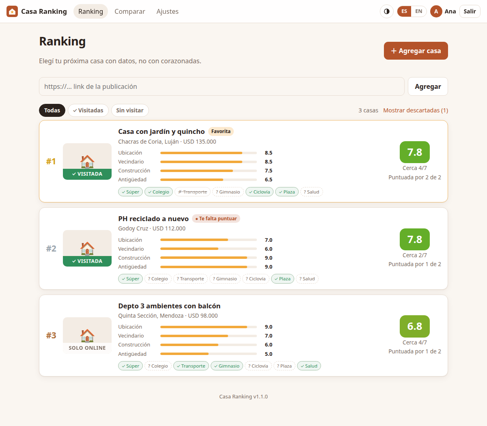
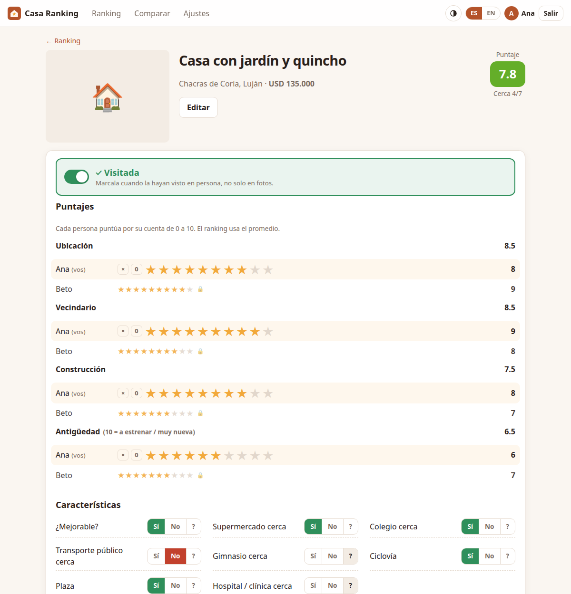
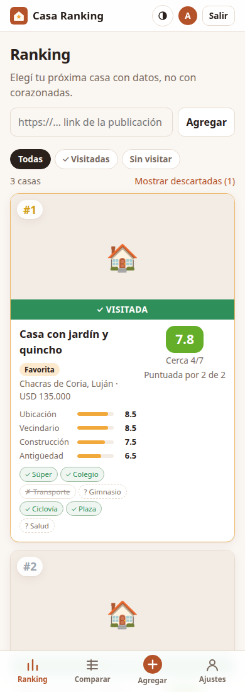
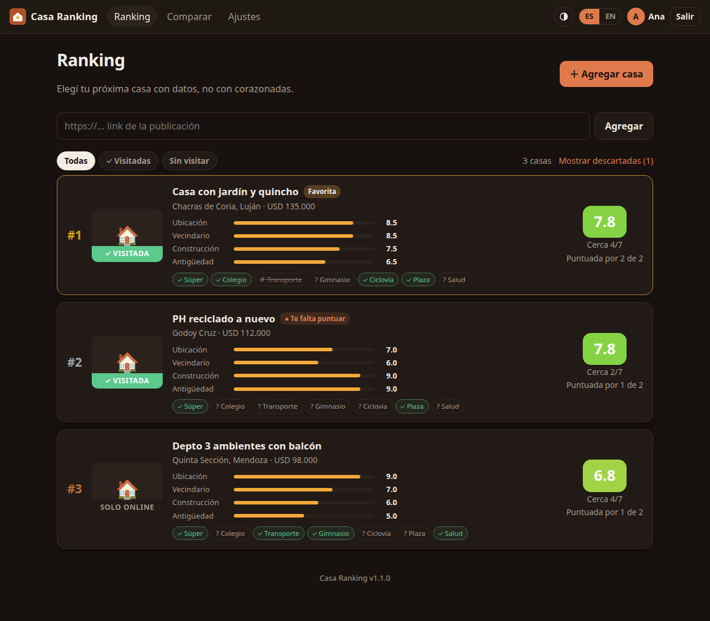

# Casa Ranking

A small self-hosted web app to **rank houses you are thinking of buying**. Paste the
listing link, each person rates it from 0 to 10 on a few topics, tick what is nearby,
and the app keeps a live ranking.

The UI is in **Spanish by default** with an English toggle. Built for a couple deciding
together, but any number of people can rate.



## Features

- **Accounts**: everyone logs in. An admin account is created on first start; the admin
  adds users (name, email, password) and decides who rates.
- **Per-person star ratings (0-10)** for *Ubicación* (location), *Vecindario*
  (neighbourhood), *Construcción* (construction), *Antigüedad* (age), *Mejorable* (how much
  better it could be made) and *¿Me gusta?* (do I like it). Each person can
  only change their own stars (enforced server side); everyone else's are shown
  read-only, and every card shows each person's own score. A "Te falta puntuar" tag
  shows which houses you still have to rate.
- **A score that means something** (0-10): each person's stars as a weighted average
  (*Ubicación* counts double by default, *Mejorable* and *¿Me gusta?* a little less than
  the rest, an unrated topic counts as 5), then everyone's
  opinions together, halfway between the average and the lowest one, so a house only
  ranks high when all of you like it. The Yes/No questions are 15% of the score. Only 10
  stars on everything from everyone plus Yes to every question gives 10.0.
- **Visited, to visit, not visited**: tabs *Todas / Visitadas / Ir a visitar / Sin
  visitar*, an "Ir a visitar" button on every house, and a green / blue / red banner.
- **Filters**: minimum score, minimum stars per topic, must-have features, price range.
- **Calendar** of visits in Argentina time (UTC-3): a month view, the day's visits and the
  upcoming ones. Each visit links to the house in the app and has notes (who you meet, what
  to ask). The next visit also shows on the house page and its ranking card.
- **Comments** on every house with their author, marked *Online* (looking at the
  listing) or *En persona* (after a visit), with a tab for each.
- **Yes / No / "No sé" questions** that count towards the score: about the house (pet friendly, pool or room for one, room for an above-ground pool) and what's nearby
  (supermarket, school, public transport, gym, bike lane, park, hospital/clinic).
- **Tunable**: topic weights, question importance and how much the questions count, in Settings.
- **Statuses**: active, favourite, discarded (discarded ones are hidden from the ranking).
- **Paste a link, get the house**: photo, price, currency, address, map coordinates and
  key facts (bedrooms, bathrooms, m², age) are read from the listing for **Inmoup,
  Inmoclick, MercadoLibre and Remax** (Argentina), each from its own structured data
  (JSON-LD, embedded page state). Other sites get a best-effort Open Graph read. Pasting
  a link that's already there takes you to that house; "Actualizar desde el link"
  re-reads it and tells you if the price changed.
- **Compare view**: every house and every criterion in one table.
- **Export** to CSV (opens in Excel / Sheets) or JSON.
- **Autosave**: ratings save as you click, no submit button.
- **Phone, tablet and desktop layouts**: bottom tab bar on phones (you will use it
  standing inside the house), light / dark / automatic theme toggle.



<p align="center"> </p>

## Run it

### Docker (any machine, amd64 or arm64)

```bash
docker run -d --name casa-ranking -p 8000:8000 -v casa-data:/data \
  -e ADMIN_PASSWORD='choose-a-password' ghcr.io/matiasmercado-ar/casa-ranking:latest
```

Open http://localhost:8000, log in as `admin`, and add the people who will rate in
*Ajustes*. Without `ADMIN_PASSWORD` a random one is printed once in `docker logs casa-ranking`.

### Docker Compose (from source)

```bash
git clone https://github.com/matiasmercado-ar/casa-ranking.git
cd casa-ranking
cp .env.example .env     # optional: admin password, port
docker compose up -d --build
```

Data lives in `./data/casa-ranking.db` (SQLite). Back it up by copying that folder or
with *Ajustes > Exportar datos*.

### Without Docker

```bash
python3 -m venv .venv && . .venv/bin/activate
pip install -r requirements.txt
uvicorn app.main:app --port 8000
```

### Proxmox LXC

`deploy/` has two scripts that create a Debian 13 LXC with Docker on a Proxmox node and
deploy the app into it over SSH:

```bash
cp deploy/deploy.env.example deploy/deploy.env   # set node, CT ID, IP, storage
deploy/proxmox-lxc.sh                            # once: creates the container
deploy/deploy.sh                                 # every update: sync, rebuild, health check
```

## Configuration

| Variable         | Default               | Meaning |
|------------------|-----------------------|---------|
| `ADMIN_EMAIL`    | `admin`               | Login of the admin account created on first start. |
| `ADMIN_PASSWORD` | *(generated, logged)* | Its password. Only read when no admin exists; change it later in Settings. |
| `SECRET_KEY`     | *(generated)*         | Session signing key; auto-generated into `data/secret.key` if unset. |
| `DATA_DIR`       | `/data` in the image  | Where the SQLite DB lives. |
| `PORT`           | `8000`                | Host port used by `docker-compose.yml`. |

Lost the admin password? Set a new one from the host:

```bash
docker compose exec casa-ranking python -c "from app import db; c=db.connect(); \
  c.execute(\"UPDATE users SET password_hash=? WHERE email='admin'\", (db.hash_password('new-password'),)); c.commit()"
```

## How the score works

For each topic the app averages the ratings of everyone who rated it. The star score is
the weighted average of those topic averages (weights default to 1).

The Yes / No / "No sé" questions then adjust it: each **Yes adds** and each **No
subtracts** `0.3 × importance`, where the admin sets each question's importance to 2
(very important, ±0.6), 1 (normal, ±0.3) or 0 (ignored). "No sé" changes nothing. The
final score is kept on the 0-10 scale, but houses are sorted by the unclamped value so
two "10"s still order correctly. Unrated houses go last.

## Stack

FastAPI, Jinja2 templates, SQLite, httpx for reading listings, and a few lines of vanilla JS. No frontend build
step, no external services: a single ~160 MB container. Tests: `pip install -r
requirements-dev.txt && pytest`.

## About

A weekend "vibe coding" project: designed and built in a conversation with an AI
coding assistant, then deployed to a home Proxmox server. MIT licensed.

---

### En español

App para **puntuar y rankear casas** que estás pensando comprar. Pegás el link de la
publicación, cada persona (con su propio usuario) puntúa de 0 a 10 *Ubicación*,
*Vecindario*, *Construcción* y *Antigüedad*,
marcás qué hay cerca (súper, colegio, transporte, gimnasio, ciclovía, plaza, salud) y
la app arma el ranking, separando las casas visitadas de las que solo vieron online. Se levanta con `docker compose up -d --build` y se usa en
http://localhost:8000.
